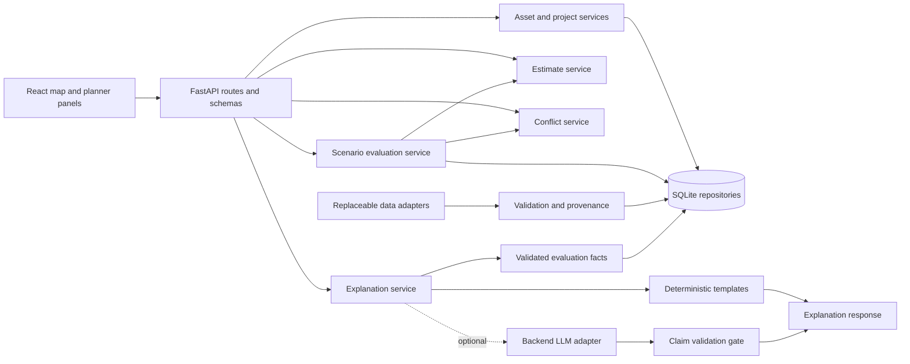

# Architecture

Status: M2 implements the existing React/FastAPI modular monolith, selectable map, related maintenance attributes, normalized assessment history, pure estimate calculations and immutable SQLite estimate snapshots. M3 adds project persistence, a pure indexed conflict engine, saved analyses and map/review UI. M3.5 fixes frontend dependency portability and freezes the proposed scenario/adapter contracts below. M4 implements the scenario/evaluation boundary below. M5 implements the bounded evidence advisor, provider/fallback and audit boundary below.


## M7 architectural decisions (7.1–7.3 implemented locally)

M0–M6 sections below record their historical delivered behavior; the current M7.2 composition supersedes the old map chrome and guide only. M7.1 now implements the local acquisition/migration/snapshot/read boundary described here; frontend ownership below reflects 7.3; comprehensive polish/accessibility remains 7.4. See [M7.1 implementation evidence](M7_1_IMPLEMENTATION.md). [M7_IMPLEMENTATION_PLAN](M7_IMPLEMENTATION_PLAN.md) maps decisions to files and gates.

| Decision | Rationale / tradeoff |
| --- | --- |
| ADR-M7-01: retain React/Vite + FastAPI + standard-library SQLite modular monolith | Existing services already isolate deterministic math and AI. No ORM, spatial server, queue, microservice or hosting rewrite. Offline prepared geographic snapshots fit a bounded pilot. |
| ADR-M7-02: explicit local ingestion, immutable official snapshots | Acquisition/validation occurs outside requests; current APIs never depend on NYC availability. Extra local disk and manual refresh are accepted for reproducibility and review. |
| ADR-M7-03: additive sidecar import tables; v1 remains synthetic | Synthetic-only validators, global IDs and one-snapshot assumptions make in-place coercion unsafe. Sidecars hold source facts, not a second application or duplicate calculator. New v2 read routes share the same process, HTTP safeguards and repository conventions. |
| ADR-M7-04: explicit mode/snapshot; no active global database selector | Context belongs to each request/URL. Multiple tabs cannot silently change each other's source universe. Published snapshots remain queryable; newer data never rewrites saved history. |
| ADR-M7-05: attributed real context with local fallback | M7.2 uses verified OSM standard raster tiles for ordinary interactive context, with its visible ODbL attribution/policy. No provider key. Approved NYC street lines/names and shoreline remain local API layers if tiles fail or VITE_BASEMAP=local. MapLibre 6.16 generates labels from system fonts without external glyphs. OSM is best-effort/no SLA; no prefetch/proxy/offline tile archives. |
| ADR-M7-06: four route views, shared feature components and state | Reduces clutter and defers WebGL/large editors. Hash routing avoids a server history fallback/dependency for four views; existing components/APIs remain reusable. Small route parser must be tested. |
| ADR-M7-07: official inspection capabilities do not inherit synthetic planning | Current Road/Evidence/Assessment/Scenario/AI contracts embed synthetic semantics and hashes. Keep existing numerical services/replay intact; official costing/screening/evaluation/AI remains unavailable in M7 pending a source-neutral version and appropriate data. A professional interface can disclose a missing capability; it cannot fabricate its inputs. |

### Ingestion modules and trust boundary

Proposed flow: allowlisted official acquisition → immutable ignored raw bytes + source metadata → adapter/typed field validation → geographic selection → normalized records + candidate matches → reviewed match manifest → deterministic dry-run report → one atomic publication transaction → v2 read repositories → React views. Neither the browser nor AI can publish imports, supply arbitrary source URLs, promote a match or mutate source facts.

Put source-specific acquisition/field mapping in `app/ingestion/`; pure conversion/selection/matching in `services/municipal_data.py`; typed DTOs in `schemas/municipal.py`; SQL in `core/municipal_repository.py`; CLI orchestration in `app/ingest.py`. Adapt existing geometry/Decimal/hash helpers where their semantics match, without changing v1 outputs. Avoid GeoPandas/GDAL unless a verified format requires it; preferred input is official GeoJSON/JSON. A FileGDB-only release may require an explicitly reviewed one-time extraction tool or narrowly scoped dependency; capture version/command/output checksums and do not silently select an unofficial mirror.

Acquisition uses the fixed reviewed resources in ingestion/registry.py, system `/usr/bin/curl` with verified HTTPS, no redirects, a 30-second attempt deadline, two bounded transient retries and 25 MB per response. Row caps bound the pilot (10,000 LION/pavement/context, 20,000 permits). No archive extraction or GDAL dependency is needed; native ArcGIS paths transform through existing pyproj. Full metadata/name-type fingerprints and before/after source update/count checks fail closed on observed drift. The normalized permit SELECT excludes contacts/company/free narrative. Official city/DOT terms return 403 to the automated downloader; reviewed official-page links are recorded separately from actual hashed portal terms/dictionaries. This limitation is explicit, never bypassed.

`app.ingest acquire` writes a new ignored evidence directory. `dry-run` verifies it, validates/normalizes, writes a new report/quarantine and performs no database writes. `publish` regenerates staging from evidence, checks the approved report hash and content identity, and requires explicit --allow-rejects for nonzero quarantines. Complete records/sources/matches/manifest plus successful import audit insert atomically with BEGIN IMMEDIATE. Required layers must all have valid rows in this pilot implementation; partial-layer snapshots are deferred. Exact repeat is a no-op; changed content creates a new immutable snapshot and an added/changed/removed diff. Acquisitions/failures/reviews remain disk evidence; current import_runs records successful publications only. It is not a durable network-job service. Failed acquisition has no completed acquisition.json and cannot be staged as success.

### Non-destructive SQLite migration and recovery

Current `initialize()` creates base tables then executes M2–M5 additive DDL in one transaction; `schema_migrations` records 2–5, not 6. It is **not** an official-data migration tool. M7.1 implements `python -m app.migrate --database ... --backup ...`; startup may continue idempotent legacy initialization but must not run schema 7, ingest or activate real data automatically. V1 must still operate on an unmigrated valid legacy DB; v2 readiness returns schema-not-ready with recovery instructions.

1. Inspect schema_migrations/table definitions read-only. Support an empty database and valid M1/M2/M3/M4/M5 shapes. Reject unknown future versions, conflicting version/name pairs and malformed legacy schemas; do not guess repairs. Run legacy integrity/FK checks. Never print row contents or environment secrets.
2. Quiesce the local API/writers. Use sqlite3's backup API into a new private timestamped ignored file (including WAL contents); do not copy only the main file while a writer is active. Verify backup integrity/FKs and a canonical per-table row-count/hash manifest for all existing tables plus schema/index/trigger definitions. Retain it; never overwrite an earlier backup. Check space/permissions and report failure before migration.
3. For earlier supported schemas, execute the established legacy DDL statements and legitimate 2–5 markers inside the **same** BEGIN IMMEDIATE transaction as schema 7; existing rows remain byte-identical. Add only the required schema-7 tables/indexes/triggers and version/name entry. Do not use executescript inside that transaction because of implicit commit behavior. Commit version marker with DDL. No DROP, table rebuild, JSON rewrite, ID renumbering, deletion or fixture reseed.
4. Recheck integrity/FKs and exact prior payload/row hashes; document only expected new schema_migrations rows and new empty tables. Repeat command is a no-op with validation. Busy/disk-full/constraint/interruption rolls back schema 7; preserve backup/report for diagnosis. Surface actionable schema errors rather than masking them as data-ready.
5. Test import separately after migration; publication never changes legacy table contents. Upgrade software and seed in either supported order must preserve local scenario edits and old evaluations. Keep seed's one-synthetic-snapshot restriction by storing official snapshots outside legacy dataset/roads.
6. Recovery: stop writers, run the previous application against the verified backup through a new configured path; retain upgraded DB and diagnostic artifacts. Never run a destructive downgrade or automatically replace/delete the original file. New official data is absent from the old version by design. Practice this on disposable copies before a user database is touched.

Automated upgrade tests cover empty/M1–M5 variants, persisted scenario evaluations, immutable triggers, malformed/future schema, repeat upgrade, startup without upgrade, committed WAL backup verification, busy writers and injected DDL/import rollback. Actual disk-full/power-loss and exhaustive audit-history variants remain unrun; the recovery procedure is rerouting the old application to the retained verified backup, never replacing the upgraded file. No ordinary user database was modified. M7.1 also verified complete preexisting table rows/schema against the backup of a new isolated pilot database containing the synthetic workflow records. This does not claim a tested power-loss recovery service.

### Frontend ownership and data flow

`App.tsx` is the shell/composition root with narrow navigation, explicit dataset/pin controls and bounded hash routing (`routing.ts`). `pages/OfficialMapPage` owns official reads/selection; `OfficialRecordsPage` owns the snapshot-wide coverage/activity/freshness overview and paginated exact-status/location permit filters with independent detail reads. `pages/SyntheticWorkspace` retains existing domain feature components in distinct hidden views. ScenarioPlanner mounts on its first visit and stays mounted across navigation and context switches; its pending writes remain bound to their original synthetic inputs and responses reconcile there. Dirty reload uses native beforeunload where supported. This in-memory preservation replaces the proposed global draft reducer; no data crosses contexts and nothing is auto-saved. M7.3 adds an inline Keep editing / explicit discard guard when another scenario would replace a dirty editor. URL/context memories are keyed by mode and official snapshot. The active route carries road/record selections, filters and official camera/layers; high-frequency edits use replaceState, deliberate navigation uses hash history. Map permit inspection and Projects permit selection have separate keys, so road navigation retains the selected administrative record without reopening its inspector. Malformed-route correction retains the mounted synthetic workspace. A full browser restart still loses unsaved input.

`services/municipal.ts` and `types/municipal.ts` isolate source-neutral v2 DTOs; v1 synthetic DTOs and calculation transport remain compatible; evaluation-history reads now supply the existing limit/offset parameters. The new read-only `http.ts` shares deadlines/cancellation/error semantics conceptually, without refactoring proven v1 mutation transport during a visual milestone. No router/state/component-library dependency. Each official read carries a pinned snapshot. Boundary checks reject mismatched versions/IDs, synthetic official payloads and unaccepted condition links. Independent hook reads are keyed by snapshot/bbox/layer, debounced and cancelled; late responses and paged searches cannot replace a newer context. No localStorage, source HTML rendering or automatic mutation retry.

Official street/inspection/permit/context layers are presentation adapters from full immutable source coordinates. Each viewport layer is bounded at 2,000 records and fully paginated in pages of 100; refinement errors never mean zero observations. Keyboard search is snapshot-wide and paginated separately. Selection fetches full detail independently of viewport membership. `permitMapFeatures` draws source geometry or a human-reviewed accepted road reference only, preserving the reference label and line geometry; it never creates a centroid/footprint from an unlocated candidate. Whole-snapshot dashboard counts come from v2, not loaded map features.

RoadMap retains MapLibre/local ESM worker, synthetic project geometry/highlighting and cleanup/resize behavior. It adds real source-name labels using local system fonts, shoreline and independently toggled official overlays. Optional OSM tiles use normal browser cache/Referer and visible attribution; tile failure hides only that background. Local mode performs no tile/font download. Source/render and WebGL/initialization failures expose retry and equivalent search/list access. Default focus is a bounded City Hall/Broadway window within the pilot; pan/zoom reads exact intersecting full geometries without clipping or invented coordinates. A 12-second initialization deadline avoids an endless map spinner.

Synthetic Projects retains ConflictReview, now with an explicit **Run conflict screening** action; simply loading projects or navigating performs no analysis POST. RepairPlanner, ScenarioPlanner/Results and AIAdvisor/review controls remain their existing feature modules; computations stay server-side. The old M6 guide/chrome is removed per the map-redesign request; fixture records, historical reports and actual planning capabilities remain. Source/terms disclosures include the mandatory NYC DOT application notice. The keyboard list independently reads inspection/located-permit records with overlays hidden and can narrow/reset geographic query bounds without WebGL. M7.3 adds saved-analysis GET restoration with snapshot checks and project/finding-to-road links. Scenario lists/catalog load once; histories are fetched per requested plan, paginated and cancellable, with local errors. Saved result links use GET and retain immutable evaluations. No route invokes POST analysis/evaluation/comparison/AI. Overview additions are repository-derived `municipal-summary-2` fields, not a client analytics engine or a schema migration. See [M7.2 report](M7_2_IMPLEMENTATION.md) and [M7.3 report](M7_3_IMPLEMENTATION.md) for exact files/tests/limits.

## M8 architecture (implemented foundation and staged proposal)

[M8_IMPLEMENTATION_PLAN](M8_IMPLEMENTATION_PLAN.md) extends ADR-M7-03/07 through separate versioned real-data contracts; no application/schema behavior changes in M8.0. Keep the React/Vite/FastAPI/SQLite modular monolith and unchanged v1 synthetic replay. Official source records remain immutable schema-7 inputs.

- ADR-M8-01: pin an immutable intelligence release over one official base snapshot. New additive association rows support reviewed many-to-many/partial road scope without overwriting schema-7 one-target matches or manifest identities. Extra sidecar storage/context complexity is accepted for historical replay and source integrity. New imports still use explicit local adapters/dry-run/quarantine/atomic publication. No auto-refresh/activation or browser/model publishing.
- ADR-M8-02: pure source-neutral association/condition/recency, costing, priority and screening services; routes validate/orchestrate, repositories own SQL, React renders. Reuse/extract Decimal and spatial/date primitives only behind v1 compatibility wrappers with identical numerical/result-hash regressions. Never cast official records into synthetic DTOs, copy demo suitability, or fork a second pricing/conflict engine. Classification/ranking policies and authored planning inputs are explicit versioned inputs.
- ADR-M8-03: new v2 intelligence/planning resources and context-specific capabilities preserve old M7 reads/pins; frozen old capability flags are not rewritten. Explicit user actions create estimates/screens/evaluations/explanation audits; no GET/navigation/pan persists a planning calculation or audit. Deterministic inspection projections may be computed on GET without writes. Official drafts have independent context, optimistic revisions and Keep/discard protection. Extend the same four-view shell/list fallback, not a second frontend.
- ADR-M8-04: additive explicit migrations by stage, starting explicit schema 8 only for release/association storage. Extend version/shape validation and readiness deliberately. Verified WAL-aware private backup, all-existing-row/schema/trigger equality, transactional DDL/publication, injected failure tests and old-software-on-backup recovery are prerequisites. No rebuild/reseed/downgrade or automatic migration at startup.
- ADR-M8-05: fact selection and deterministic rendering remain the AI boundary. Official evidence/notes require a separate six-classification projection with exact frozen source/association/policy/calculation hashes; no source text, geometry, contacts, model tools or source mutation. Provider optional; no-key path complete. No general agent or autonomous decision system.

M8.1 implements road associations plus the user-expanded conservative condition/recency inspector and layer reads. A1 remains open; see M8_1_IMPLEMENTATION. Later stage schemas/services/UI are added when their gates permit, without unused placeholders. Existing Shapely/pyproj/SQLite are sufficient; no new dependencies proposed. Section 9 of the plan extends the existing migration/recovery procedure to all 26 pre-M8 tables and saved official/synthetic histories. Performance remains a measured bounded-pilot gate, not a reason to introduce microservices, PostGIS, background jobs or OR-Tools.

## Boundaries and data flow

React/Vite is a separate presentation client of one FastAPI process. Python domain services own all calculations; the browser formats results and gathers scenario inputs. Pydantic validates API contracts; SQLite stores normalized records and immutable evaluation snapshots. No microservices, Kubernetes, spatial database server, or background queue is needed for the demo.



`routes/` handles HTTP; `schemas/` request/response validation; `models/` persistence records; `services/` domain functions and orchestration; `core/` configuration, errors, repositories, adapter interfaces, and audit helpers. Submodules are introduced with their milestone, not as unused source placeholders. Routes never perform spatial math or embed prompts; domain functions never call an LLM or HTTP service.

Implemented web features group map, assets, estimates, conflicts, scenarios, and contextual AI explanations. `services/` holds the typed API client; `types/` mirrors validated transport shapes; no calculation is duplicated in components.

## Calculation services

M2 uses Decimal: `bundled_roadwork = area_m2 × scenario_rate`; `subtotal = rounded_roadwork + rounded_mobilization + rounded_traffic_allowance`; `contingency = round(subtotal × contingency_fraction)`; `total = subtotal + contingency`. Materials/labor/equipment are included once in the bundled rate. Quantities, rate units, rates, exclusions, bounds, and method versions are evidence inputs. Round each line to cents with ROUND_HALF_UP, then subtotal; round contingency to cents and add. Persist integer cents; serialize money as two-decimal USD strings. Costs are estimates, not bids.

M2 duration is `ceil(area_m2 / productivity_m2_per_active_workday) + setup_days + curing_days`. It separates active workdays, setup and curing allowances; these sequential preliminary days are not a contractor calendar or elapsed scheduled dates. No inferred crew/weather model. The current catalog has no lifespan field or sourced lifespan values; lifespan remains unknown. A future option may carry explicitly sourced assumption bounds, never a prediction of actual pavement performance. Bounds are sensitivity ranges, not statistical confidence intervals unless a justified model is later added. Missing dimensions/rates block the affected estimate; do not substitute zero.

## Geographic and temporal rules

- Exchange GeoJSON in EPSG:4326, longitude then latitude. Require valid finite coordinates and supported geometry types; preserve original geometry and source CRS metadata. Reject rather than silently repair malformed features.
- Transform to EPSG:32618 (metres, NYC study window) for length, distance, and buffer operations. GeoPandas may handle bulk ingestion; Shapely handles domain geometry. Record CRS and library/method versions. Never buffer decimal degrees or treat a centerline as measured pavement area.
- MVP spatial candidate rule: projected distance between project footprints is at most `proximity_m`. The default **screening assumption** is 5 m; this is not calibrated to real utility positional accuracy. It is a screening tolerance, not utility positional accuracy. Use direct distance or buffer one geometry once, avoiding accidental doubled tolerance. Intersection at the boundary counts as proximity.
- Dates are local civil dates in America/New_York with half-open intervals `[start_date, end_date)`. Temporal overlap: `max(starts) < min(ends)`. Adjacent intervals do not overlap. Calendar-day durations are date differences; audit timestamps use UTC.
- Emit `concurrent_work` when proximity and interval overlap hold. Emit `reopening_risk` when utility work is nearby and starts from 0 through `reopening_horizon_days` after road repair ends (inclusive threshold; default review horizon 30). Reopening is a potential restoration risk, not a predicted event.
- Missing dates or geometry produce `indeterminate` checks with missing-field evidence, not negative findings. Existing known findings remain visible even if some other projects cannot be checked. Coverage status is independent of finding count.
- No observed utility location/depth is inferred from a permit or a line intersection. Grade-separated crossings and permits without confirmed schedules require human interpretation. Deduplicate findings by ordered project pair, rule type, and method version.

M3 caps each analysis at 50 projects. STRtree directly supplies proximity candidates and footprint-to-road corridor memberships; inverted road memberships supply shared-road candidates. Unknown geometries pair explicitly with all active records. Dense/shared-road/unknown sets can still yield O(n²) candidates, which is necessary to retain their evidence; unrelated known footprints avoid a full geometric all-pairs scan. No large-scale performance claim has been measured. NetworkX is reserved for stretch detours; OR-Tools is deferred unless a documented scheduling/selection formulation exceeds simple enumeration.

## Scenario preparation and evaluation boundary

M3.5 was design preparation only; M4 now implements these contracts as detailed below. DATA_MODEL owns `scenario-v1`, `scenario-action-v1`, QuantityProposal and `schedule-proposal-v1`; API_SPEC owns the proposed transport. Existing M2/M3 numerical outputs, fixtures and hashes remain authoritative.

A scenario is a manually authored set of proposed actions, never an edit to the asset or project store. Whole-segment quantity resolves existing planning dimensions; partial-area and trench scopes need supplied area/dimensions plus provenance. Unknown scope stays unavailable. M4 factors quantity-based cost assembly from `services/estimates.calculate` into one pure validated helper and retain the M2 dimension wrapper and `repair-estimate-v1` results. No duplicate pricing formulas, invented dimensions or new area input on the existing estimate endpoint. Scenario costing has a distinct `scenario-cost-v1` version and freezes every selected option, source, quantity and adjustment.

The only priced catalog methods today are preventive, resurface and reconstruct. Patch and trench restoration are proposed extensions requiring reviewed method/rate/productivity/scope sources before any price can be returned. The old demo's alternative prices and total-wide sensitivity multipliers are retired. M2 sensitivity changes bundled rates only; fixed mobilization/traffic allowances remain fixed and contingency is recalculated. All current lifespans are unknown. DATA_MODEL and DEMO_PLAN specify the authoritative synthetic arithmetic.

Calendar dates are supplied proposals independent of preliminary active/setup/curing duration. Optional calendars only record assumptions; no date conversion or optimization is implemented or implied. Unknown dates yield null elapsed/closure metrics and incomplete pair checks, while an independently known cost may remain available. Closure intervals explicitly state lanes and whether setup/curing are included; an estimate does not imply a closure. Constraints are validated, not automatically scheduled. Deferral always retains unresolved engineering/safety review.

Evaluation uses the same baseline_source_hash, price basis, cost scope and horizon across alternatives. The baseline covers original road/catalog/external-project/evidence contents before overrides; scenario-specific actions, assumption sources and overrides may differ and remain separately frozen. This permits alternatives without comparing stale baseline data. Sum complete low/base/high action costs. Default mobilization is per action; an explicit group requires priced replacement lines, allocation/evidence and contingency recalculation through the same helper. Never infer a saving, remove setup time or share traffic allowances because dates overlap. Unsupported group adjustment is rejected until implemented. `within_budget` uses central total ≤ budget; incomplete cost forces `indeterminate`, and upper-bound affordability is separately nullable. A conflict alone never creates a repeat-restoration action or monetary loss.

Elapsed days is latest supplied action end minus earliest supplied start; null when any action dates are incomplete. Lane-closure-days sums the explicitly supplied nonoverlapping per-action closure intervals × lanes, including repeat work; null when required closure declarations are absent. Cross-action overlaps can double count and are labeled as such. This is not vehicle delay. Lifespans remain per action and null without source evidence. Persist canonical source/action/provenance/parameter snapshots and method versions; new inputs produce a new evaluation without rewriting old history.

## Hypothetical conflict adapter (implemented M4)

Keep one conflict engine. The internal adapter accepts validated immutable snapshots, does not read live mutable records during screening, and has no repository or HTTP mutation capability. It prepares M3 inputs then calls `services.conflicts.analyze` once. No clone of the spatial/date rules and no change to `/conflicts/analyze` is needed.

Conceptual typed interface (future M4 Python implementation using existing Pydantic `Schema`, `WorkProject`, `Road`, `Evidence`, geometry and `AnalysisParameters` validation):

```text
prepare_hypothetical_screen(
    scenario_snapshot: ScenarioSnapshot,
    proposed_projects: list[HypotheticalProjectSnapshot],
    external_projects: list[WorkProject],
    roads: list[Road], sources: list[Evidence], parameters: AnalysisParameters
) -> PreparedScreen | UnavailableScreen

screen_hypothetical(prepared: PreparedScreen) -> HypotheticalConflictScreen
# delegates numerical screening to analyze(prepared.projects, roads, parameters, sources)
```

`HypotheticalProjectSnapshot` contains `action_id`, immutable complete action/scope/quantity/schedule/provenance snapshot, explicit geometry or null with location basis, explicit dates or null with reasons, and a validated `work_project` projection plus `hypothetical=true`. The adapter constructs and validates the projection from the action; arbitrary client-supplied WorkProject payloads do not cross the REST boundary. `PreparedScreen` contains the canonical proposal snapshot, sorted validated engine inputs, originals, overrides, action-to-project mapping, parameters, complete evidence contents, adapter version and input hash. `UnavailableScreen` has a typed reason and missing inputs; it never masquerades as zero findings.

Preparation rules:

1. Resolve and freeze all references in one dataset snapshot; reject unknown/mismatched references, duplicate IDs, conflicting source contents and invalid geometry/intervals. Require an explicit external-project selection. After overrides, total input projects (including cancelled rows) must be 1–50; an empty scope returns `not_run/EMPTY_SCOPE`, and an oversized scope is a validation error, never truncated.
2. Validate `project_overrides` against that selected scope. `exclude` removes only the chosen snapshot from this hypothetical run. `replace` removes its original and requires explicit replacement actions that reference it in related_project_ids. Keep original records and reasons/evidence in the wrapper snapshot. No replacement from proximity, road identity or related-project linkage alone. Reject conflicting operations. The persistent project payloads and links remain untouched.
3. Generate collision-checked stable projection IDs `demo-hyp-<SHA256(action semantic snapshot)>` for current synthetic proposals, with a bijection to action IDs. Use fixed scenario-source timestamps in projections, not the evaluation clock. Preserve explicit proposed schedules as `planned`, basis `assumed_demo`; actual dates remain null. Retain original related-project dates only in provenance, never silently copy them as proposed dates.
4. Project implemented preventive actions to road_repair/road_resurfacing/maintenance, resurface to road_repair/road_resurfacing/resurfacing, reconstruct to road_repair/road_reconstruction/reconstruction. These mappings are versioned adapter policy. For patch/restoration/unknown categories, preserve an `other/other/other` projection and emit `UNCLASSIFIED_REOPENING_RULE`: generic proximity/overlap checks may run, but reopening-rule completeness is indeterminate until a reviewed mapping exists. Never relabel patch as resurfacing to force a rule result.
5. Use only the explicitly supplied action geometry (including an explicitly cited approximate corridor reference); null stays null. Keep original source geometry in provenance. Do not derive a work polygon from cost quantity or infer buried utilities. Use supplied action calendar envelope for M3 temporal screening. If closure intervals differ, preserve them in the wrapper and warn that M3 multiple_closures is an envelope screening signal; exact closure-day totals remain the separate scenario metric. For a nonempty closure list project lanes_closed as the maximum declared count, explicitly labeled an envelope summary; a sourced empty list maps to 0. With unknown closure declarations pass lanes_closed=null, never an inferred value. Do not copy source-project costs: estimated_cost_usd remains null with a separate-estimate reason.
6. Reuse existing complete Evidence records for current fixtures; render inline scenario assumptions as complete synthetic demo Evidence records in the wrapper, never database inserts. Preserve all original source contents; pass exactly the source-ID union referenced by projected projects and roads to the M3 engine (it rejects missing or extra sources). Current Road/Evidence contracts are synthetic-only. Unsupported observed-source shapes return `UNSUPPORTED_SOURCE_CONTRACT`, never coercion to synthetic or a claim of observed coverage. General observed adapters require a separate versioned extension.
7. Invoke unchanged `conflict-screen-v1` geometry/date screening with the existing CRS/library metadata, including shared-road ambiguity, incomplete checks and unknown coverage. No engine recalculation in the frontend or LLM. Save only within a scenario-evaluation snapshot; never call ConflictRepository.save or insert hypotheses/findings into work_projects, project_roads, conflict_analyses or conflict_findings.

`HypotheticalConflictScreen` contains `adapter_version=hypothetical-conflict-adapter-v1`, `analysis_context=hypothetical`, `scenario_id`, proposal/input/result hashes, `project_origins` mapping each engine ID to `{origin: proposed_action|existing_project, action_id or project_id}`, original/excluded/replaced project snapshots, assumption sources, adapter_indeterminate_checks (including unclassified reopening rules), warnings and the unchanged full M3 `ConflictAnalysis` (or explicit not-run reason). Include all quantity/schedule/constraint/override/source contents and adapter/method/library versions in wrapper input identity, even when a field does not affect M3 math. Exclude newly generated wrapper IDs/timestamps from semantic hashes; retain frozen source timestamps that are part of M3 inputs.

Each finding has wrapper `finding_context=hypothetical` if either participant is a proposal; otherwise `existing_project_screen`. Both are derived screenings, never verified observations of an actual collision. The independent synthetic flag propagates all source dependencies; hypothetical status must not be inferred from that flag alone. The existing demo's persisted projects are themselves fictional. Complete spatial_evidence, temporal_evidence, evidence IDs, review requirements, M3 method version and uncertainty stay intact. A zero-finding hypothetical run still has unknown utility coverage; a missing/unclassified input is not safe clearance.

M4 adapter tests must cover same-source replacement without self-conflict/double counting, explicit exclusions with retained originals, mixed existing/proposed pairs, partial/unknown geometry and dates, unclassified patch/restoration rules, source/parameter mutation, stable reordered-input hashes, closure-envelope limitations, 0/50/51 project boundaries and zero database writes. M3.5 has not implemented or claimed these tests pass.

## AI and persistence

The explanation service reads saved evaluation facts, then renders deterministic templates or calls an optional backend provider. It never writes estimates, projects, or scenarios. Strict claim references and rendered numerical facts gate generated output; failure returns deterministic text. See AI_SYSTEM.

SQLite stores entity references, indexed IDs/date fields, geometry JSON text, evidence, scenario actions, and snapshot JSON. Shapely performs spatial operations in memory; no SpatiaLite requirement. Enforce foreign keys and transactionally save evaluations/audits. M1 uses the Python standard-library sqlite3 driver, with three tables (`dataset`, `evidence`, `roads`) and validated JSON payloads. Connections are short-lived, SQL is parameterized, foreign keys are enabled, and imports are transactional. There is one immutable demo snapshot per database; schema initialization uses CREATE TABLE IF NOT EXISTS, with no migration framework. M2 adds `schema_migrations`, `fixture_imports`, `maintenance_assets`, `assessments`, `repair_options` and `estimates`. Existing M1 payloads are untouched. Estimate JSON retains immutable inputs/results with low/base/high integer-cent columns, foreign keys and update/delete rejection triggers. M4 adds append-only scenario evaluations and optimistic mutable drafts as detailed below. Frozen GeoJSON/JSON fixture imports are repeatable by manifest IDs and checksums.

## Errors, security, and evolution

Use the API error envelope with field errors and request IDs. Schema violations are 422, unknown IDs 404, incompatible scenario/snapshot state 409, unavailable storage 503, unexpected failures 500. A valid but incomplete dataset returns warnings/indeterminate results rather than a success-shaped empty clearance. Provider failures use an explicit fallback response.

MVP is local-only, unauthenticated, with restricted local CORS. Do not expose it publicly. Later commercial work requires identity/roles, tenant scoping in every repository, isolation tests, durable backups, retention, ingestion jobs, licensing review, security assessment, and municipal procurement/engineering review. Adapter and repository interfaces permit those changes without splitting the monolith prematurely.

TBD decisions and recommendations are tracked in FOUNDATION_INSPECTION. M1 dependency versions are pinned in apps/web/package-lock.json and apps/api/requirements.txt; see README for prerequisites.

## Implemented M1 path and scope reconciliation

`GET /api/v1/road-segments/geojson` → RoadRepository → SQLite → validated Road/FeatureCollection → centralized web API client → MapLibre local GeoJSON source. React owns selection; road detail and evidence are separately read through REST. Dataset counts use the fully loaded collection; a search does not change the snapshot counts. Loading and failure states do not fabricate records. Requests have abort support and a 10-second timeout.

The original roadmap deferred SQLite to M2. The explicit M1 request requires persistence and repeatable seeding, so M1 brings forward only road/evidence storage. A synthetic `condition_summary` read projection supports the requested map categories without pretending to implement full ConditionAssessment lifecycle/selection. This is documented in DATA_MODEL and API_SPEC. No estimates, conflicts, projects, AI or scenario work was brought forward.

Default map style: local background-only MapLibre style with API GeoJSON, no remote tile/font/sprite URLs. Attribution: CivicPlAIn synthetic schematic; no municipal observations; no basemap tiles. The MapLibre 6 ESM worker is bundled locally via a Vite URL import and setWorkerUrl, following the [official migration guidance](https://maplibre.org/maplibre-gl-js/docs/guides/v5-to-v6-migration-guide/). Map and resource/WebGL failures keep the equivalent searchable road list available. There is no optional online basemap to fail over from; the documented empty-style fallback is the default.

Local CORS is restricted to explicit loopback HTTP origins. Configuration uses environment variables without an implicit dotenv loader. Startup creates an empty schema; explicit `python -m app.seed` validates manifest checksums, count/IDs, geometry, evidence and bounds before any transactional import. Changed manifests cannot overwrite the same snapshot. Runtime databases and build outputs are ignored.

## Implemented M2 boundaries and migration

`services/estimates.py` is independently callable with validated Road, Assessment, RepairOption and optional PlanningAssumptions objects. It imports neither FastAPI nor SQLite, and performs no HTTP/model calls. `routes/planning.py` resolves references, checks snapshot identity, calls the engine and persists a new UUID estimate. `core/planning_repository.py` owns assessment/catalog/snapshot SQL. RoadRepository overlays related asset dimensions and the latest assessment on reads so collection, GeoJSON and detail agree, while raw M1 rows remain byte-identical. The bounded ≤30-road demo accepts this simple per-record repository lookup; bulk loading can follow measured need.

M2 migration `m2-additive-v1` uses an explicit BEGIN IMMEDIATE transaction and executes only CREATE TABLE/INDEX/TRIGGER IF NOT EXISTS, then records version 2 transactionally. The existing three-table store is preserved. Connections close after each operation; foreign keys and transactions apply. No reset, schema drop or import runs on server startup. Explicit seed runs checksum-verify reviewed M2 records, reject changed fixture manifests, and INSERT OR IGNORE; user-modified existing rows are not overwritten. Runtime databases remain ignored. Estimate snapshots are append-only through API and SQLite triggers; this is not a tamper-proof database or production audit system.

Geographic scope: M2 does **not** calculate distances, buffers or lengths from longitude/latitude. Authored synthetic lengths and widths define a hypothetical rectangular repair scope, independent of the drawn centerline. Area is their product and retains both dimension sources. No measured/derived ground-distance accuracy is asserted. M2 estimates do not use geographic projection. M3 now implements the separate EPSG:32618 conflict screening contract described below.

The web `features/estimates/RepairPlanner` consumes API comparisons/history and saves then retrieves the selected estimate. It only formats money, quantities and explicitly displayed fractions as percentages; it does not calculate costs or duration. All alternatives remain inspectable even when the condition rule does not indicate them. Missing-dimension previews return null and a reason; POST requires an explicit assumption to fill the gap. No recommendation model, approval control, budget optimization or project scheduling was introduced.

## Implemented M3 methodology and boundaries

`schemas/conflicts.py` owns WorkProject, geometry, parameters, findings and analysis contracts. `services/conflicts.py` accepts validated projects, roads, parameters and complete source records; it imports neither FastAPI nor persistence nor an AI provider. `core/conflict_repository.py` saves/reads validated records; routes only resolve inputs, validate references and orchestrate analysis. The existing React map receives API project geometry; `features/conflicts` supplies loading/retry, selected scopes, textual evidence and layer controls. Browser visibility does not alter the checked scope.

The only added direct dependency is **pyproj 3.7.2**, pinned with the existing dependency set. It uses local PROJ definitions and `Transformer.from_crs(4326, 32618, always_xy=True)`; Shapely 2.2 supplies transforms and STRtree. Source and calculation CRS plus Shapely, GEOS, pyproj and PROJ versions are frozen in each snapshot. References: [pyproj Transformer](https://pyproj4.github.io/pyproj/stable/api/transformer.html), [Shapely STRtree](https://shapely.readthedocs.io/en/stable/strtree.html). Work polygons/lines must lie within the study window; coordinates are not silently clipped or repaired. Polygon rings must close explicitly; nonfinite coordinates, invalid topology and zero-area polygons are rejected. M1 road import semantics are unchanged.

Candidates are the union of direct footprint distance ≤ proximity (default 5 m), shared declared affected roads, geometries within `corridor_m` (default 5 m) of the same road centerline, and every pair involving missing geometry. The corridor screen means independent distance to the same centerline; it is not measured pavement width or proof that two excavations touch. Direct distance uses one tolerance, never two buffered footprints. Boundary contact counts as proximity, but only positive polygon intersection area counts as polygon overlap. A **1e-7 m numerical epsilon** accommodates projection roundoff at thresholds; it is not a physical uncertainty allowance. Distance display rounding never controls classification.

Evidence classifications are `confirmed_geometric_overlap` only for positive polygon overlap with neither footprint marked approximate, `shared_affected_road`, `proximity_based_potential_overlap` (including corridor-only and line-crossing candidates), and `insufficient_spatial_information`. The word confirmed refers solely to supplied geometry, never field verification. Approximate overlapping demo polygons retain `polygon_overlap=true` but receive potential-overlap classification. Missing geometry can coexist with a shared-road finding and an indeterminate footprint check. Unknown dates/geometry yield explicit record warnings; spatially related incomplete pairs are listed separately from findings. Known separated geometry does not need a temporal pair evaluation. Zero findings never changes utility coverage from unknown.

Rules use `[start,end)` local civil dates. Cancelled projects are explicitly excluded. Completed projects use actual dates only, never planned dates as completion evidence, and can only be the preceding side of a sequential finding. Active/planned/tentative records use their supplied planned intervals; no dates are inferred from today's date. Overlap emits `concurrent_work`; overlapping non-completed records with declared positive lane closures on a shared road/corridor additionally emit `multiple_closures`. A nonnegative gap from 0 through the configured horizon (default 30, inclusive) emits `reopening_risk` when resurfacing/reconstruction precedes utility work with affirmative excavation or excavation work type not explicitly negated. Other sequential related work emits `sequencing_review`. Every priority is `coordination_review`, a policy label without validated safety significance. Missing lane declarations do not become closure facts. No cost is added or inferred.

Analysis snapshots freeze sorted projects/roads/source contents, parameters and method/library versions. Canonical hashes use the existing M2 sorted-key compact ASCII JSON helper. Analysis ID is `analysis-<input SHA256>`; findings hash the input hash, sorted pair and rule. The result hash excludes detection timestamps. Identical repeated requests reuse the first saved result/time; altered inputs/parameters get new IDs. Source or project edits cannot rewrite prior snapshots. Replaying the pure service against saved validated inputs reproduces semantic hashes in the recorded runtime. Cross-library-version equivalence is not promised; versions form part of input identity.

The additive `m3-additive-v1` migration creates `work_projects`, `project_roads`, `conflict_analyses`, `conflict_findings`, lookup indexes and immutable analysis/finding triggers. It records version 3 and preserves existing tables/payloads. Seeding validates checksums, identities, source/road/snapshot references, then adds records transactionally using stable IDs. Existing local project payloads and road links are preserved on repeated seed. There is no project mutation endpoint; future import/edit adapters must update payloads and normalized links together. Saved analyses provide calculation history. M5 adds scoped AI interaction audits and human review notes below; a general cross-module AuditEvent stream remains a future contract.

False positives include broad shared road IDs, remote work along one long corridor, approximate footprints, grade-separated crossings, permit windows, changed schedules and lanes declared for separate portions. False negatives remain possible with unlisted projects, incorrect source geometry/scope and unknown utility coverage. This prototype cannot determine engineering interference, authorize excavation, recommend safe deferral, compute traffic delay or guarantee savings. This describes the historical M3 boundary; M4 and M5 additions follow below.

## Implemented M4 modules and boundaries

M4 realizes the M3.5 design above; future-tense preparation text describes the originating contract, not additional runtime capabilities. `core/scenario_inputs` resolves and validates references/source-record provenance, captures the bounded road/catalog baseline and selected original project contents, and creates inline synthetic assumption sources. `core/scenario_repository` owns optimistic revisions, normalized action/project links and immutable evaluation SQL. `routes/scenarios` handles REST validation/errors and orchestration. The current source APIs are read-only; evaluation operates on the frozen context rather than re-reading mutable sources during arithmetic/screening.

`services/estimates.cost_scenarios` is the single low/base/high line/allowance/contingency implementation factored from M2 without changing its output shape or formulas. `services/scenarios` resolves quantities, stores action input/cost snapshots and M2 suitability, aggregates cents with Decimal, calculates budget sensitivity and supplied-schedule metrics. Empty/partial inputs stay unavailable. `services/hypothetical.screen` builds validated WorkProject projections and invokes the unchanged M3 analyze function once; it imports no repositories or mutation tools. Only scenario_evaluations receives proposed findings. New runs retain all 24 bounded road snapshots for M3 corridor screening, not just declared affected roads; context.screen_road_scope versions that input-universe choice. Pre-release evaluations created during this implementation retain their recorded narrower context for replay, and comparison rejects differing screening-road scopes. Explicit replacements retain original project snapshots and do not change real project records. A missing scope returns EMPTY_SCOPE; >50 effective projects is rejected. Observed-source adapters remain unsupported.

`services/scenario_identity` sorts set-like proposal lists for stable identity, preserving geometry coordinate semantics. `services.scenarios.replay` recomputes entirely from the frozen evaluation input, without live repositories. Engine CRS/library metadata is retained inside the full M3 analysis. Proposal projections have collision-checked semantic hashes and fixed scenario-source timestamps. No evaluation clock affects the M3 finding result hash. Content-addressed evaluations reuse their first persisted timestamp; old snapshots remain valid after scenario/catalog/source changes.

`services/scenario_comparison` is the separate lightweight planning helper. It checks common original-source hashes, horizon, cost scope/currency, price dates, versions and screening parameters. Rows/deltas/tradeoffs use saved evaluations only. Scope/assumption differences are explicit; missing objective values prohibit corresponding cost deltas/dominance. Conservative dominance compares only disclosed fully available numerical objectives for matching scope/assumptions/budgets, without a weighted rank or municipal recommendation. No OR-Tools, services split, migration framework, dependency or optimization platform was introduced.

React `features/scenarios` integrates with App's current selected road and existing map/list, uses centralized typed REST requests, supports editor/list/evaluation/history/comparison and renders server metrics. It does not perform costing, spatial screening or schedule conversion. The initial editor covers catalog methods, whole/partial/unknown quantities, supplied dates/closure envelopes, related projects and explicit exclusions/replacements. Justified repeat work has an explicit stage/justification control. Advanced per-interval calendars/precedence are supported by the API and preserved by the editor, but do not have specialized editor controls. Shared mobilization remains explicitly rejected. Generative explanation/provider/review-event work stays in M5.

## Implemented M5 explanation boundary

`routes/ai.py` validates bounded record-reference requests using `schemas/ai.py`, retrieves evidence through the existing repositories, and delegates to `services/ai`. `evidence.py` builds traceable typed projections and validates source hashes/replay; `providers.py` owns the provider protocol, official SDK adapter, deterministic selection, per-process usage ceiling and concurrency control; `explanations.py` owns local question routing, structured selection/citation validation, source-only rendering and fallback. Deterministic domain services import no AI code. `core/ai_repository.py` persists reduced evidence projections and minimal interaction metadata, plus separate explicitly submitted human review notes.

The provider has no SQL, files, arbitrary Python, web access or mutation tools. Only selected fact/evidence IDs, template/review codes and the exact context hash are accepted; the server renders all claims. No model-written factual prose is returned. The existing monolith and `/api/v1` boundary are preserved. Runtime table creation is additive migration 5; no existing estimate, conflict or scenario payload is rewritten. See [AI_SYSTEM](AI_SYSTEM.md) for configuration, limits, privacy and residual risks.

`features/ai/AIAdvisor` is shared by the existing road, project, estimate, conflict, evaluation and scenario-comparison views. It calls the central typed API client, displays server values and evidence references, keeps facts distinct from review templates, and cancels requests when context changes. It never invents output on API failure. ReviewNote submits only a human-authored local annotation, independently of the model.


## M6 final integration and runtime boundary

The modular monolith, REST boundary, SQLite schema and M1–M5 calculation/provider contracts remain unchanged. No migration, new dependency, pricing method or post-MVP capability was introduced. The current status/verification authority is [FINAL_QA_REPORT](FINAL_QA_REPORT.md).

React lazily imports MapLibre and the scenario planner separately from the shell. Shared condition colors reside in a small module so legends do not import the WebGL engine. Feature error boundaries preserve the rest of the workspace if a module fails; maps retain their existing construction/resource-error road-list fallback. Map project-source updates are separate from highlight-filter changes. Planner navigation opens the existing editor instead of toggling/unmounting it. A lightweight guide resolves known synthetic IDs against actual loaded API records and only navigates/selects; it never seeds or creates analytical results.

`core/http_limits.py` buffers at most 1 MiB of request body before parsing, applies a 10-second arrival deadline and rejects foreign browser origins for mutation methods. CORS and request correlation surround this guard; errors stay sanitized. This limits one class of local resource/origin misuse without claiming a production rate limiter or identity system. AI retains its independent evidence/output/concurrency/hourly bounds.

`scripts/demo.py` uses standard-library subprocesses, explicit loopback ports, API readiness polling, forced deterministic AI and a new ignored SQLite path per run. It retains every database and stops only child process groups. A production invocation builds the frontend with the matching API URL before preview. Safe recovery is fresh isolated initialization rather than deleting/editing existing demo records. POSIX/macOS was verified; cross-platform packaging is outside M6.

### M8.1 implementation checkpoint

`services/road_intelligence` reuses the existing projected candidate engine to derive immutable zero/one/many road-reference overlays. `core/intelligence_repository` owns snapshot-bound SQL/atomic publication; `app.ingest intelligence-dry-run|intelligence-publish` extends the existing reviewed local entry point. M7 adapters/acquisition/staging identities stay unchanged. `models/migrations` explicitly supports target 8, including shape validation and verified backup; `app.migrate` still defaults to 7. Startup never activates schema 8.

Pure `services/road_conditions` owns latest eligible selection and explicit-date recency. Existing municipal routes orchestrate validated read projections; React renders them, selects releases explicitly and keeps raw source layers separate. No persisted calculation/audit occurs on GET. Current/history layer filtering derives the complete context before applying viewport bounds, preventing viewport-dependent latest selection. Original schema-7 reads remain compatible without an overlay. [M8_1_IMPLEMENTATION](M8_1_IMPLEMENTATION.md) records successful isolated real-pilot migration/replay/publication/preservation; original pilot remains schema 7. The [owner-approved pilot checkpoint](M8_1_PILOT_IMPLEMENTATION.md) now supplies five reviewed partial links on a second isolated copy; complete source-edition/scope and recovery gates remain open.


### M8.1 explicit project pilot grading

Pure `services/pavement_policy` owns the owner-approved Decimal half-up policy and canonical policy hash; `road_conditions` composes it only under explicit policy/base/release/date context. It adds `road-condition-v2-pilot` read projections, not a second importer, planning engine, persisted GET result or schema 9. No-policy v1 semantics/hashes remain unchanged. Routes apply the same complete accepted-assessment projection before road filtering or map GeoJSON. React renders only validated matching context, raw history and policy metadata; it never classifies scores itself. Five owner-approved annotations use existing schema-8 immutable publication with optional complete candidate-set hash validation. No whole-road/pass evidence or official DOT policy is inferred. See [pilot implementation](M8_1_PILOT_IMPLEMENTATION.md).

## M8.2 permit intelligence extension

Current scope: [M8_2_IMPLEMENTATION](M8_2_IMPLEMENTATION.md). Existing acquisition/adapter/staging/publication modules handle an explicit bounded administrative-window query and optionally reuse checksum-verified pinned non-permit archives. Existing shared review-overlay builder accepts a permit contract and method parameters while preserving condition defaults/hashes. `services/permit_intelligence.py` owns pure deterministic candidate/location/window screening; `schemas/permit_intelligence.py` validates projections. `core/intelligence_repository.py` atomically persists the same release family to the separate additive schema-9 permit association table. No schema-8 rewrite or automatic migration.

V2 Projects opts into enhanced evidence. Process-local two-context LRU caches immutable projections; locked construction avoids duplicate concurrent builds, and only accepted/rejected review rows are needed by projections. All requests still validate base/release membership. GET screening is explicit one-record-vs-imported-set computation, paginated and ephemeral, with no DB/audit mutation or network. It does not call project/scenario engines. No frontend domain math, external utility inference, autonomous acceptance, synthetic fallthrough, dependency addition or deployment. CLI migration/publication remains explicit; original DBs were preserved and only a verified private copy was migrated.


## M8.3 official-road planning boundary

`schemas/municipal_planning.py` validates source-neutral explicit inputs; `services/municipal_estimates.py` freezes the exact road/source/base and applies `municipal-area-cost-v1`. Pure `services/cost_math.py` shares existing Decimal money/area/allowance/contingency/workday arithmetic with the unchanged synthetic wrappers. No municipal DTO is coerced into an M2 Road/RepairOption and no synthetic rate catalog is read. `core/municipal_planning_repository.py` owns explicit schema-10 immutable snapshots/idempotent publication and pure hash/replay validation; `routes/municipal_planning.py` extends v2 only. GET/navigation never calculates or saves an estimate. Preview POST is write-free; save POST independently recalculates. React collects assumptions and renders server facts. Citations are inert human assertions, never a URL fetcher or verified catalog. No provider, AI prose, condition recommendation, official scenario adapter or M8.4 engine is added.

Migration 10 is additive, explicit, backed up/shape-checked and transactional; startup/default migration target remain unchanged. Recovery stops writers, retains failed artifacts and restores the verified private pre-migration copy under a new path, then re-pins the same snapshot; no destructive downgrade or original overwrite. Future method versions must retain v1 replay semantics, not silently swap a catalog or arithmetic. See [M8_3_IMPLEMENTATION](M8_3_IMPLEMENTATION.md).


## M8.4 transparent review-priority extension

`schemas/prioritization.py` validates policies/universe/constraints. Pure `services/prioritization.py` computes Decimal review scores, ties, eligibility and sensitivity; it uses no SQL, provider, network or synthetic rate catalog. `core/prioritization_repository.py` collects exact immutable M8.1 condition evidence through the existing summary service, verifies explicitly chosen M8.3 estimates, freezes road/source/base/release/match data, and atomically publishes schema-11 runs. Saved reads replay their frozen projections and arithmetic rather than current catalogs/observations. Existing M2/M4 services and validators remain unchanged. `routes/prioritization.py` orchestrates v2 requests and context-bound reads/filter/compare only. `features/priorities/RoadPriorities` is shared by the existing Dashboard and Map, renders server numbers and source facts, and keeps per-snapshot drafts in session memory. Opening/navigation performs no ranking POST. Map selection uses official reference geometry and carries saved as-of/release context; it does not manufacture condition colors or physical work footprints. Additive migration 11 uses existing full-row/schema preservation, explicit private backup and rollback. Default target remains 7. No second importer/app, dependencies, AI advisor, optimizer or M8.5 module.

## M8.5 construction screening boundary

`official_screening_repository` collects pinned official records and separately supplied hypothetical/documentary work into `official_screening` (pure deterministic service); v2 `official_screening` routes expose explicit preview/save/history/notes. M3's synthetic/bounded `WorkProject`/`Road` validators remain intact. Reused M3 metric transformer/roundoff epsilon and extracted shared `screening_math.overlap_bounds` preserve existing half-open interval behavior and hashes; official data are never coerced into synthetic DTOs. At most 60 work/admin entries use complete bounded pair enumeration, preserving all missing-location checks without an unnecessary optimizer/index dependency.

EPSG:4326 supplied geometry is topology-validated without repair, constrained to the actual snapshot coverage and projected to existing EPSG:32618. Source WKT without a verified CRS remains uninterpreted. Same-road references are contextual; conflict findings require both usable supplied geometries and explicit date intervals. Different declared grades suppress geometric-interference findings; unknown grade qualifies potential coordination and leaves checks indeterminate. Shape overlap verifies only supplied 2D shapes, never field conditions/depth. Existing M8.2 administrative-window screening remains separately labeled.

Schema 12 is additive, explicitly backed up, transactional and immutable for both runs and separate notes; default migration remains 7, startup does not migrate/activate/import. Freeze full road matching universe and source/release/record inputs for reproducibility. Replay rejects incompatible GIS versions rather than silently recalculating under changed libraries. Restore a verified prior backup to a new path with writers stopped, verify old rows/schema/FKs and explicitly select it; do not downgrade/reseed/overwrite originals. Recovered older schemas return unavailable for new persistence. No official scenario/AI execution is introduced.

## M8.6 integration boundary

The existing React application shares `features/decisions/DecisionContext` across Map inspector, Overview, Projects and official Scenarios. Existing estimate/priority/screening editors remain authoritative; explicit saved IDs load read-only without replacing per-context drafts. The map uses distinct condition, selected-policy ranked/unranked, permit-candidate road-reference and supplied-work overlay sources, with text/list access. Planning tools occupy the existing inspector column or mobile sheet, one at a time. Large frozen JSON renders only on disclosure. Enhanced road-permit candidate matching loads when requested, preventing a full cold permit projection from blocking initial street rendering.

`routes/decision_support.py` composes existing repositories and `road_conditions.summarize`; no parallel importer/engine, new dependency or migration. Summary histories are metadata only; selected details and explanation requests replay through existing repositories. `services/ai/official_evidence.py` is an allowlisted scalar projector into the existing selection-only AI service; raw source narrative, geometry and review notes never reach the provider. Explicit POST alone adds the existing audit. GET never calculates/persists a planning run or AI interaction. General official scenario CRUD/evaluations and broad production/performance certification remain deferred. [M8.6 evidence](M8_6_IMPLEMENTATION.md).

## Standardized street read model

The focused owner-authorized integration adds `core/standardized_repository.py` and `routes/standardized.py` inside the existing monolith. `CIVICPLAIN_STANDARDIZED_DATABASE_PATH` defaults to the supplied ignored processed SQLite artifact. Every connection uses a properly encoded SQLite file URI, `mode=ro`, `query_only=ON`, contract-column checks and source-snapshot validation; connections close after each request. Parameterized selected-road view queries are bounded and stably ordered. There is no importer, adapter, matcher, dependency, migration or startup dataset mutation. Existing official and planning storage remain independent.

`services/standardized.ts` verifies returned contract/snapshot/road identity. `features/standardized/StreetEvidence.tsx` supplies the primary official selected-street inspector with condition, permits and on-demand paged activity. Requests abort on context changes/unmount; the component is keyed by exact snapshot/road, so a previous street cannot retain its lists or late results. Existing map selection/highlight, search, route persistence and fallback list are reused. Whole-segment verification/source history is preserved in a closed disclosure; repair/saved tools remain deliberate actions. Indicative evidence is never passed to engineering calculations or AI. Original official map overlays/filters and Overview continue to describe their original verified-evidence contract, independently of indicative street categories.

## M9 map presentation and performance

MapLibre starts with the local style and registers infrastructure sources on local load. Optional OSM raster attaches below infrastructure afterward, so tile load/failure cannot block official-layer readiness. Layer switches change layout visibility on the same instance; failure retains local geometry and keyboard access. No tile prefetch, proxy or offline tile download is introduced. The geographic margin described below applies only to local data.

`services/viewportCache.ts` owns covering-bounds LRU entries and ref-counted abortable identical requests. Each mounted official Map owns bounded caches: municipal layers share at most 24 entries/12,000 records; indicative ratings have the same independent bound. Context keys include snapshot, layer, every exact filter and release/policy/date; ratings use exact snapshot plus indicative-map contract. Complete coverage only, 20% geographic margin on each side, clipped to approved map bounds. Broad margins retry exact visible coverage under a different cache key. Rejected/aborted/partial pages never publish. LRU eviction removes oldest coverage; unmount drops caches, requests cancel when their last consumer leaves, and reload starts empty. No TTL or automatic refresh of immutable pinned data. Replacing a local standardized artifact requires explicit operator action and a frontend reload to clear already loaded views.

`useViewportLayer` debounces 180ms, reuses covering entries and retains previous geometry only within identical context while a complete new view loads. Render-time identity gating and cancellation prevent foreign snapshot/filter flashes and late results. Errors disclose retained prior coverage; broad views require zoom rather than incomplete success. Roads use a single <=2000 page with all existing provenance; inspection/permit reads retain complete existing cursor loops. No full histories are requested just to color roads.

The standardized repository lazily builds one process-local Shapely STRtree (existing dependency) from read-only profiles, bounded to 100,000 roads; larger artifacts fail explicitly. Warm views query exact intersections in the tree rather than scan SQLite geometry JSON. Identity includes resolved artifact path, inode, size, mtime_ns and source snapshot; replacement invalidates the index. SQLite remains URI mode=ro/query_only, schema and metadata checked on each read. No artifact indexes, migrations, files or metadata are written. The client never supplies these indicative profiles to calculation or AI modules.

Separate `ratings` GeoJSON source and `indicative-ratings`/`rating-hit` layers use stored bands and stable road IDs. Unknown/missing/Unclassified is neutral; original numeric values stay in the inspector. Existing verified road colors, observations, permits, candidates, priorities, supplied work and selection remain separate. Source updates compare stable reference and, when necessary, content; changing an unrelated overlay or visibility does not re-send roads. Development-only bounded counters/timing samples live in `window.civicplainMapMetrics` and `[map-count]`/`[map-time]` console entries; no record IDs, source text, coordinates, user data or provider calls are logged. Production builds omit recording.
