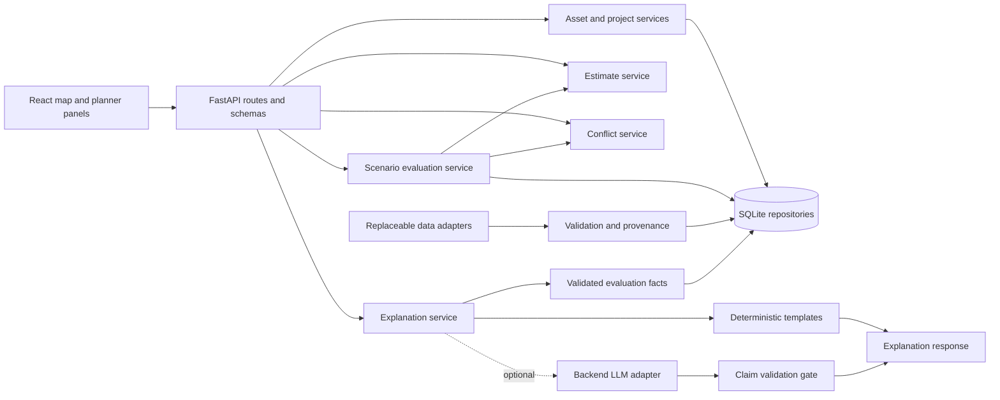

# Architecture

Status: M2 implements the existing React/FastAPI modular monolith, selectable map, related maintenance attributes, normalized assessment history, pure estimate calculations and immutable SQLite estimate snapshots. M3 adds project persistence, a pure indexed conflict engine, saved analyses and map/review UI. M3.5 fixes frontend dependency portability and freezes the proposed scenario/adapter contracts below. Scenarios and AI remain unimplemented.

## Boundaries and data flow

React/Vite is a separate presentation client of one FastAPI process. Python domain services own all calculations; the browser formats results and gathers scenario inputs. Pydantic validates API contracts; SQLite stores normalized records and immutable evaluation snapshots. No microservices, Kubernetes, spatial database server, or background queue is needed for the demo.



`routes/` handles HTTP; `schemas/` request/response validation; `models/` persistence records; `services/` domain functions and orchestration; `core/` configuration, errors, repositories, adapter interfaces, and audit helpers. Submodules are introduced with their milestone, not as unused source placeholders. Routes never perform spatial math or embed prompts; domain functions never call an LLM or HTTP service.

Planned web features group map, assets, estimates, conflicts, scenarios, and explanations. `services/` holds the typed API client; `types/` mirrors validated transport shapes; no calculation is duplicated in components.

## Calculation services

M2 uses Decimal: `bundled_roadwork = area_m2 × scenario_rate`; `subtotal = rounded_roadwork + rounded_mobilization + rounded_traffic_allowance`; `contingency = round(subtotal × contingency_fraction)`; `total = subtotal + contingency`. Materials/labor/equipment are included once in the bundled rate. Quantities, rate units, rates, exclusions, bounds, and method versions are evidence inputs. Round each line to cents with ROUND_HALF_UP, then subtotal; round contingency to cents and add. Persist integer cents; serialize money as two-decimal USD strings. Costs are estimates, not bids.

M2 duration is `ceil(area_m2 / productivity_m2_per_active_workday) + setup_days + curing_days`. It separates active workdays, setup and curing allowances; these sequential preliminary days are not a contractor calendar or elapsed scheduled dates. No inferred crew/weather model. The current catalog has no lifespan field or sourced lifespan values; lifespan remains unknown. A future option may carry explicitly sourced assumption bounds, never a prediction of actual pavement performance. Bounds are sensitivity ranges, not statistical confidence intervals unless a justified model is later added. Missing dimensions/rates block the affected estimate; do not substitute zero.

## Geographic and temporal rules

- Exchange GeoJSON in EPSG:4326, longitude then latitude. Require valid finite coordinates and supported geometry types; preserve original geometry and source CRS metadata. Reject rather than silently repair malformed features.
- Transform to EPSG:32618 (metres, NYC study window) for length, distance, and buffer operations. GeoPandas may handle bulk ingestion; Shapely handles domain geometry. Record CRS and library/method versions. Never buffer decimal degrees or treat a centerline as measured pavement area.
- MVP spatial candidate rule: projected distance between project footprints is at most `proximity_m`. The default **screening assumption** is 5 m; this is not calibrated to real utility positional accuracy. It is a screening tolerance, not utility positional accuracy. Use direct distance or buffer one geometry once, avoiding accidental doubled tolerance. Intersection at the boundary counts as proximity.
- Dates are local civil dates in America/New_York with half-open intervals `[start_date, end_date)`. Temporal overlap: `max(starts) < min(ends)`. Adjacent intervals do not overlap. Calendar-day durations are date differences; audit timestamps use UTC.
- Emit `concurrent_work` when proximity and interval overlap hold. Emit `reopening_risk` when utility work is nearby and starts from 0 through `reopening_horizon_days` after road repair ends (inclusive threshold; default review horizon 30). Reopening is a potential restoration risk, not a predicted event.
- Missing dates or geometry produce `indeterminate` checks with missing-field evidence, not negative findings. Existing known findings remain visible even if some other projects cannot be checked. Coverage status is independent of finding count.
- No observed utility location/depth is inferred from a permit or a line intersection. Grade-separated crossings and permits without confirmed schedules require human interpretation. Deduplicate findings by ordered project pair, rule type, and method version.

M3 caps each analysis at 50 projects. STRtree directly supplies proximity candidates and footprint-to-road corridor memberships; inverted road memberships supply shared-road candidates. Unknown geometries pair explicitly with all active records. Dense/shared-road/unknown sets can still yield O(n²) candidates, which is necessary to retain their evidence; unrelated known footprints avoid a full geometric all-pairs scan. No large-scale performance claim has been measured. NetworkX is reserved for stretch detours; OR-Tools is deferred unless a documented scheduling/selection formulation exceeds simple enumeration.

## Scenario preparation and evaluation boundary

M3.5 is design preparation only: no new runtime service, schemas, route, database table, pricing method or UI. DATA_MODEL owns `scenario-v1`, `scenario-action-v1`, QuantityProposal and `schedule-proposal-v1`; API_SPEC owns the proposed transport. Existing M2/M3 numerical outputs, fixtures and hashes remain authoritative.

A scenario is a manually authored set of proposed actions, never an edit to the asset or project store. Whole-segment quantity resolves existing planning dimensions; partial-area and trench scopes need supplied area/dimensions plus provenance. Unknown scope stays unavailable. The M4 implementation should factor quantity-based cost assembly from `services/estimates.calculate` into one pure validated helper and retain the M2 dimension wrapper and `repair-estimate-v1` results. No duplicate pricing formulas, invented dimensions or new area input on the existing estimate endpoint. Future scenario costing has a distinct `scenario-cost-v1` version and freezes every selected option, source, quantity and adjustment.

The only priced catalog methods today are preventive, resurface and reconstruct. Patch and trench restoration are proposed extensions requiring reviewed method/rate/productivity/scope sources before any price can be returned. The old demo's alternative prices and total-wide sensitivity multipliers are retired. M2 sensitivity changes bundled rates only; fixed mobilization/traffic allowances remain fixed and contingency is recalculated. All current lifespans are unknown. DATA_MODEL and DEMO_PLAN specify the authoritative synthetic arithmetic.

Calendar dates are supplied proposals independent of preliminary active/setup/curing duration. Optional calendars only record assumptions; no date conversion or optimization is implemented or implied. Unknown dates yield null elapsed/closure metrics and incomplete pair checks, while an independently known cost may remain available. Closure intervals explicitly state lanes and whether setup/curing are included; an estimate does not imply a closure. Constraints are validated, not automatically scheduled. Deferral always retains unresolved engineering/safety review.

For future evaluation, use the same baseline_source_hash, price basis, cost scope and horizon across alternatives. The baseline covers original road/catalog/external-project/evidence contents before overrides; scenario-specific actions, assumption sources and overrides may differ and remain separately frozen. This permits alternatives without comparing stale baseline data. Sum complete low/base/high action costs. Default mobilization is per action; an explicit group requires priced replacement lines, allocation/evidence and contingency recalculation through the same helper. Never infer a saving, remove setup time or share traffic allowances because dates overlap. Unsupported group adjustment is rejected until implemented. `within_budget` uses central total ≤ budget; incomplete cost forces `indeterminate`, and upper-bound affordability is separately nullable. A conflict alone never creates a repeat-restoration action or monetary loss.

Elapsed days is latest supplied action end minus earliest supplied start; null when any action dates are incomplete. Lane-closure-days sums the explicitly supplied nonoverlapping per-action closure intervals × lanes, including repeat work; null when required closure declarations are absent. Cross-action overlaps can double count and are labeled as such. This is not vehicle delay. Lifespans remain per action and null without source evidence. Persist canonical source/action/provenance/parameter snapshots and method versions; new inputs produce a new evaluation without rewriting old history.

## Hypothetical conflict adapter (proposed interface, not implemented)

Keep one conflict engine. The future internal adapter accepts validated immutable snapshots, does not read live mutable records during screening, and has no repository or HTTP mutation capability. It prepares M3 inputs then calls `services.conflicts.analyze` once. No clone of the spatial/date rules and no change to `/conflicts/analyze` is needed.

Conceptual typed interface (future M4 Python implementation using existing Pydantic `Schema`, `WorkProject`, `Road`, `Evidence`, geometry and `AnalysisParameters` validation):

```text
prepare_hypothetical_screen(
    scenario_snapshot: ScenarioSnapshot,
    proposed_projects: list[HypotheticalProjectSnapshot],
    external_projects: list[WorkProject],
    roads: list[Road], sources: list[Evidence], parameters: AnalysisParameters
) -> PreparedScreen | UnavailableScreen

screen_hypothetical(prepared: PreparedScreen) -> HypotheticalConflictScreen
# delegates numerical screening to analyze(prepared.projects, roads, parameters, sources)
```

`HypotheticalProjectSnapshot` contains `action_id`, immutable complete action/scope/quantity/schedule/provenance snapshot, explicit geometry or null with location basis, explicit dates or null with reasons, and a validated `work_project` projection plus `hypothetical=true`. The adapter revalidates the projection against the action; arbitrary client-supplied WorkProject payloads do not cross the REST boundary. `PreparedScreen` contains the canonical proposal snapshot, sorted validated engine inputs, originals, overrides, action-to-project mapping, parameters, complete evidence contents, adapter version and input hash. `UnavailableScreen` has a typed reason and missing inputs; it never masquerades as zero findings.

Preparation rules:

1. Resolve and freeze all references in one dataset snapshot; reject unknown/mismatched references, duplicate IDs, conflicting source contents and invalid geometry/intervals. Require an explicit external-project selection. After overrides, total input projects (including cancelled rows) must be 1–50; an empty scope returns `not_run/EMPTY_SCOPE`, and an oversized scope is a validation error, never truncated.
2. Validate `project_overrides` against that selected scope. `exclude` removes only the chosen snapshot from this hypothetical run. `replace` removes its original and requires explicit replacement actions that reference it in related_project_ids. Keep original records and reasons/evidence in the wrapper snapshot. No replacement from proximity, road identity or related-project linkage alone. Reject conflicting operations. The persistent project payloads and links remain untouched.
3. Generate collision-checked stable projection IDs `demo-hyp-<SHA256(action semantic snapshot)>` for current synthetic proposals, with a bijection to action IDs. Use fixed scenario-source timestamps in projections, not the evaluation clock. Preserve explicit proposed schedules as `planned`, basis `assumed_demo`; actual dates remain null. Retain original related-project dates only in provenance, never silently copy them as proposed dates.
4. Project implemented preventive actions to road_repair/road_resurfacing/maintenance, resurface to road_repair/road_resurfacing/resurfacing, reconstruct to road_repair/road_reconstruction/reconstruction. These mappings are versioned adapter policy. For patch/restoration/unknown categories, preserve an `other/other/other` projection and emit `UNCLASSIFIED_REOPENING_RULE`: generic proximity/overlap checks may run, but reopening-rule completeness is indeterminate until a reviewed mapping exists. Never relabel patch as resurfacing to force a rule result.
5. Use only the explicitly supplied action geometry (including an explicitly cited approximate corridor reference); null stays null. Keep original source geometry in provenance. Do not derive a work polygon from cost quantity or infer buried utilities. Use supplied action calendar envelope for M3 temporal screening. If closure intervals differ, preserve them in the wrapper and warn that M3 multiple_closures is an envelope screening signal; exact closure-day totals remain the separate scenario metric. For a nonempty closure list project lanes_closed as the maximum declared count, explicitly labeled an envelope summary; a sourced empty list maps to 0. With unknown closure declarations pass lanes_closed=null, never an inferred value. Do not copy source-project costs: estimated_cost_usd remains null with a separate-estimate reason.
6. Reuse existing complete Evidence records for current fixtures; render inline scenario assumptions as complete synthetic demo Evidence records in the wrapper, never database inserts. Preserve all original source contents; pass exactly the source-ID union referenced by projected projects and roads to the M3 engine (it rejects missing or extra sources). Current Road/Evidence contracts are synthetic-only. Unsupported observed-source shapes return `UNSUPPORTED_SOURCE_CONTRACT`, never coercion to synthetic or a claim of observed coverage. General observed adapters require a separate versioned extension.
7. Invoke unchanged `conflict-screen-v1` geometry/date screening with the existing CRS/library metadata, including shared-road ambiguity, incomplete checks and unknown coverage. No engine recalculation in the frontend or LLM. Save only within a future scenario-evaluation snapshot; never call ConflictRepository.save or insert hypotheses/findings into work_projects, project_roads, conflict_analyses or conflict_findings.

`HypotheticalConflictScreen` contains `adapter_version=hypothetical-conflict-adapter-v1`, `analysis_context=hypothetical`, `scenario_id`, proposal/input/result hashes, `project_origins` mapping each engine ID to `{origin: proposed_action|existing_project, action_id or project_id}`, original/excluded/replaced project snapshots, assumption sources, adapter_indeterminate_checks (including unclassified reopening rules), warnings and the unchanged full M3 `ConflictAnalysis` (or explicit not-run reason). Include all quantity/schedule/constraint/override/source contents and adapter/method/library versions in wrapper input identity, even when a field does not affect M3 math. Exclude newly generated wrapper IDs/timestamps from semantic hashes; retain frozen source timestamps that are part of M3 inputs.

Each finding has wrapper `finding_context=hypothetical` if either participant is a proposal; otherwise `existing_project_screen`. Both are derived screenings, never verified observations of an actual collision. The independent synthetic flag propagates all source dependencies; hypothetical status must not be inferred from that flag alone. The existing demo's persisted projects are themselves fictional. Complete spatial_evidence, temporal_evidence, evidence IDs, review requirements, M3 method version and uncertainty stay intact. A zero-finding hypothetical run still has unknown utility coverage; a missing/unclassified input is not safe clearance.

M4 adapter tests must cover same-source replacement without self-conflict/double counting, explicit exclusions with retained originals, mixed existing/proposed pairs, partial/unknown geometry and dates, unclassified patch/restoration rules, source/parameter mutation, stable reordered-input hashes, closure-envelope limitations, 0/50/51 project boundaries and zero database writes. M3.5 has not implemented or claimed these tests pass.

## AI and persistence

The explanation service reads saved evaluation facts, then renders deterministic templates or calls an optional backend provider. It never writes estimates, projects, or scenarios. Strict claim references and rendered numerical facts gate generated output; failure returns deterministic text. See AI_SYSTEM.

SQLite stores entity references, indexed IDs/date fields, geometry JSON text, evidence, scenario actions, and snapshot JSON. Shapely performs spatial operations in memory; no SpatiaLite requirement. Enforce foreign keys and transactionally save evaluations/audits. M1 uses the Python standard-library sqlite3 driver, with three tables (`dataset`, `evidence`, `roads`) and validated JSON payloads. Connections are short-lived, SQL is parameterized, foreign keys are enabled, and imports are transactional. There is one immutable demo snapshot per database; schema initialization uses CREATE TABLE IF NOT EXISTS, with no migration framework. M2 adds `schema_migrations`, `fixture_imports`, `maintenance_assets`, `assessments`, `repair_options` and `estimates`. Existing M1 payloads are untouched. Estimate JSON retains immutable inputs/results with low/base/high integer-cent columns, foreign keys and update/delete rejection triggers. Scenario evaluations are not implemented. Frozen GeoJSON/JSON fixture imports are repeatable by manifest IDs and checksums.

## Errors, security, and evolution

Use the API error envelope with field errors and request IDs. Schema violations are 422, unknown IDs 404, incompatible scenario/snapshot state 409, unavailable storage 503, unexpected failures 500. A valid but incomplete dataset returns warnings/indeterminate results rather than a success-shaped empty clearance. Provider failures use an explicit fallback response.

MVP is local-only, unauthenticated, with restricted local CORS. Do not expose it publicly. Later commercial work requires identity/roles, tenant scoping in every repository, isolation tests, durable backups, retention, ingestion jobs, licensing review, security assessment, and municipal procurement/engineering review. Adapter and repository interfaces permit those changes without splitting the monolith prematurely.

TBD decisions and recommendations are tracked in FOUNDATION_INSPECTION. M1 dependency versions are pinned in apps/web/package-lock.json and apps/api/requirements.txt; see README for prerequisites.

## Implemented M1 path and scope reconciliation

`GET /api/v1/road-segments/geojson` → RoadRepository → SQLite → validated Road/FeatureCollection → centralized web API client → MapLibre local GeoJSON source. React owns selection; road detail and evidence are separately read through REST. Dataset counts use the fully loaded collection; a search does not change the snapshot counts. Loading and failure states do not fabricate records. Requests have abort support and a 10-second timeout.

The original roadmap deferred SQLite to M2. The explicit M1 request requires persistence and repeatable seeding, so M1 brings forward only road/evidence storage. A synthetic `condition_summary` read projection supports the requested map categories without pretending to implement full ConditionAssessment lifecycle/selection. This is documented in DATA_MODEL and API_SPEC. No estimates, conflicts, projects, AI or scenario work was brought forward.

Default map style: local background-only MapLibre style with API GeoJSON, no remote tile/font/sprite URLs. Attribution: CivicPlAIn synthetic schematic; no municipal observations; no basemap tiles. The MapLibre 6 ESM worker is bundled locally via a Vite URL import and setWorkerUrl, following the [official migration guidance](https://maplibre.org/maplibre-gl-js/docs/guides/v5-to-v6-migration-guide/). Map and resource/WebGL failures keep the equivalent searchable road list available. There is no optional online basemap to fail over from; the documented empty-style fallback is the default.

Local CORS is restricted to explicit loopback HTTP origins. Configuration uses environment variables without an implicit dotenv loader. Startup creates an empty schema; explicit `python -m app.seed` validates manifest checksums, count/IDs, geometry, evidence and bounds before any transactional import. Changed manifests cannot overwrite the same snapshot. Runtime databases and build outputs are ignored.

## Implemented M2 boundaries and migration

`services/estimates.py` is independently callable with validated Road, Assessment, RepairOption and optional PlanningAssumptions objects. It imports neither FastAPI nor SQLite, and performs no HTTP/model calls. `routes/planning.py` resolves references, checks snapshot identity, calls the engine and persists a new UUID estimate. `core/planning_repository.py` owns assessment/catalog/snapshot SQL. RoadRepository overlays related asset dimensions and the latest assessment on reads so collection, GeoJSON and detail agree, while raw M1 rows remain byte-identical. The bounded ≤30-road demo accepts this simple per-record repository lookup; bulk loading can follow measured need.

M2 migration `m2-additive-v1` uses an explicit BEGIN IMMEDIATE transaction and executes only CREATE TABLE/INDEX/TRIGGER IF NOT EXISTS, then records version 2 transactionally. The existing three-table store is preserved. Connections close after each operation; foreign keys and transactions apply. No reset, schema drop or import runs on server startup. Explicit seed runs checksum-verify reviewed M2 records, reject changed fixture manifests, and INSERT OR IGNORE; user-modified existing rows are not overwritten. Runtime databases remain ignored. Estimate snapshots are append-only through API and SQLite triggers; this is not a tamper-proof database or production audit system.

Geographic scope: M2 does **not** calculate distances, buffers or lengths from longitude/latitude. Authored synthetic lengths and widths define a hypothetical rectangular repair scope, independent of the drawn centerline. Area is their product and retains both dimension sources. No measured/derived ground-distance accuracy is asserted. M2 estimates do not use geographic projection. M3 now implements the separate EPSG:32618 conflict screening contract described below.

The web `features/estimates/RepairPlanner` consumes API comparisons/history and saves then retrieves the selected estimate. It only formats money, quantities and explicitly displayed fractions as percentages; it does not calculate costs or duration. All alternatives remain inspectable even when the condition rule does not indicate them. Missing-dimension previews return null and a reason; POST requires an explicit assumption to fill the gap. No recommendation model, approval control, budget optimization or project scheduling was introduced.

## Implemented M3 methodology and boundaries

`schemas/conflicts.py` owns WorkProject, geometry, parameters, findings and analysis contracts. `services/conflicts.py` accepts validated projects, roads, parameters and complete source records; it imports neither FastAPI nor persistence nor an AI provider. `core/conflict_repository.py` saves/reads validated records; routes only resolve inputs, validate references and orchestrate analysis. The existing React map receives API project geometry; `features/conflicts` supplies loading/retry, selected scopes, textual evidence and layer controls. Browser visibility does not alter the checked scope.

The only added direct dependency is **pyproj 3.7.2**, pinned with the existing dependency set. It uses local PROJ definitions and `Transformer.from_crs(4326, 32618, always_xy=True)`; Shapely 2.2 supplies transforms and STRtree. Source and calculation CRS plus Shapely, GEOS, pyproj and PROJ versions are frozen in each snapshot. References: [pyproj Transformer](https://pyproj4.github.io/pyproj/stable/api/transformer.html), [Shapely STRtree](https://shapely.readthedocs.io/en/stable/strtree.html). Work polygons/lines must lie within the study window; coordinates are not silently clipped or repaired. Polygon rings must close explicitly; nonfinite coordinates, invalid topology and zero-area polygons are rejected. M1 road import semantics are unchanged.

Candidates are the union of direct footprint distance ≤ proximity (default 5 m), shared declared affected roads, geometries within `corridor_m` (default 5 m) of the same road centerline, and every pair involving missing geometry. The corridor screen means independent distance to the same centerline; it is not measured pavement width or proof that two excavations touch. Direct distance uses one tolerance, never two buffered footprints. Boundary contact counts as proximity, but only positive polygon intersection area counts as polygon overlap. A **1e-7 m numerical epsilon** accommodates projection roundoff at thresholds; it is not a physical uncertainty allowance. Distance display rounding never controls classification.

Evidence classifications are `confirmed_geometric_overlap` only for positive polygon overlap with neither footprint marked approximate, `shared_affected_road`, `proximity_based_potential_overlap` (including corridor-only and line-crossing candidates), and `insufficient_spatial_information`. The word confirmed refers solely to supplied geometry, never field verification. Approximate overlapping demo polygons retain `polygon_overlap=true` but receive potential-overlap classification. Missing geometry can coexist with a shared-road finding and an indeterminate footprint check. Unknown dates/geometry yield explicit record warnings; spatially related incomplete pairs are listed separately from findings. Known separated geometry does not need a temporal pair evaluation. Zero findings never changes utility coverage from unknown.

Rules use `[start,end)` local civil dates. Cancelled projects are explicitly excluded. Completed projects use actual dates only, never planned dates as completion evidence, and can only be the preceding side of a sequential finding. Active/planned/tentative records use their supplied planned intervals; no dates are inferred from today's date. Overlap emits `concurrent_work`; overlapping non-completed records with declared positive lane closures on a shared road/corridor additionally emit `multiple_closures`. A nonnegative gap from 0 through the configured horizon (default 30, inclusive) emits `reopening_risk` when resurfacing/reconstruction precedes utility work with affirmative excavation or excavation work type not explicitly negated. Other sequential related work emits `sequencing_review`. Every priority is `coordination_review`, a policy label without validated safety significance. Missing lane declarations do not become closure facts. No cost is added or inferred.

Analysis snapshots freeze sorted projects/roads/source contents, parameters and method/library versions. Canonical hashes use the existing M2 sorted-key compact ASCII JSON helper. Analysis ID is `analysis-<input SHA256>`; findings hash the input hash, sorted pair and rule. The result hash excludes detection timestamps. Identical repeated requests reuse the first saved result/time; altered inputs/parameters get new IDs. Source or project edits cannot rewrite prior snapshots. Replaying the pure service against saved validated inputs reproduces semantic hashes in the recorded runtime. Cross-library-version equivalence is not promised; versions form part of input identity.

The additive `m3-additive-v1` migration creates `work_projects`, `project_roads`, `conflict_analyses`, `conflict_findings`, lookup indexes and immutable analysis/finding triggers. It records version 3 and preserves existing tables/payloads. Seeding validates checksums, identities, source/road/snapshot references, then adds records transactionally using stable IDs. Existing local project payloads and road links are preserved on repeated seed. There is no project mutation endpoint; future import/edit adapters must update payloads and normalized links together. Saved analyses provide calculation history; the general AuditEvent and human review-note API remain future M5 work, not implemented here.

False positives include broad shared road IDs, remote work along one long corridor, approximate footprints, grade-separated crossings, permit windows, changed schedules and lanes declared for separate portions. False negatives remain possible with unlisted projects, incorrect source geometry/scope and unknown utility coverage. This prototype cannot determine engineering interference, authorize excavation, recommend safe deferral, compute traffic delay or guarantee savings. M4/M5 were not started.
